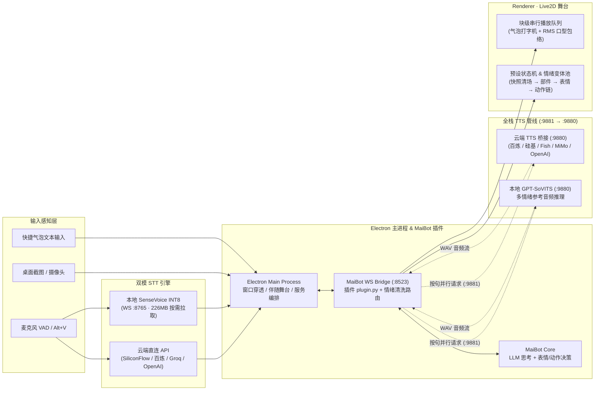

<div align="center">

<picture>
  <source media="(prefers-color-scheme: dark)" srcset="docs/assets/hero-dark.svg" />
  <source media="(prefers-color-scheme: light)" srcset="docs/assets/hero-light.svg" />
  
</picture>

<br />

[](https://github.com/Maboroshinatsu/maibot-deskpet-plugin/releases/tag/v1.0.0)
[](https://github.com/Maboroshinatsu/maibot-deskpet-plugin/releases/download/v1.0.0/MaiBot-Deskpet-Setup-1.0.0.exe)
[](https://www.electronjs.org/)
[](https://www.live2d.com/)
[](https://github.com/MaiM-with-u/MaiBot)
[](LICENSE)

**[下载 v1.0.0 安装包](https://github.com/Maboroshinatsu/maibot-deskpet-plugin/releases/tag/v1.0.0)** &nbsp;·&nbsp; **[核心特性](#-核心特性矩阵)** &nbsp;·&nbsp; **[系统架构](#-系统架构与数据流)** &nbsp;·&nbsp; **[快速开始](#-快速开始)** &nbsp;·&nbsp; **[语音管线对比](#-轻量化双模语音管线)** &nbsp;·&nbsp; **[v1.0 升级全记录](docs/UPGRADE-AND-FIX-LOG-2026-10-12.md)** &nbsp;·&nbsp; **[模型适配规范](docs/MODEL-ADAPTER-SPEC.md)**

</div>

---

## ✦ 核心特性矩阵

<picture>
  <source media="(prefers-color-scheme: dark)" srcset="docs/assets/bento-dark.svg" />
  <source media="(prefers-color-scheme: light)" srcset="docs/assets/bento-light.svg" />
  
</picture>

| 工程维度 | 核心设计亮点 |
| :--- | :--- |
| **伴随式交互舞台** | 打开设置时桌宠窗口自动平滑缩入左下角卡片舞台，右侧停靠半透明毛玻璃面板；捏表情、编排动作、切换部件与调整旋转角度均可实时预览，彻底告别弹窗遮挡模型。 |
| **预设工坊与情绪变体池** | 支持将**多层表情叠加 + 串行动作队列 + 部件显隐开关 + 循环兜底动作**打包为状态预设；同一情绪可绑定多个变体并配置权重随机抽签，每次进入新状态前自动恢复默认快照清场。 |
| **逆变换视线与块级口型** | 基于二维刚体逆变换矩阵解算鼠标坐标，模型任意旋转（`-180° ~ 180°`）、镜像或缩放后视线依然精准跟随；长回复按句切块并行合成 TTS，WebAudio RMS 包络实时驱动 `ParamMouthOpenY`。 |
| **双模语音与按需加载** | 安装包从 `~900 MB` 瘦身至 **`112.4 MB`**；默认支持硅基流动免费 SenseVoice 云端秒级转写，也可切换本地离线模式（首次自动从镜像拉取 `226 MB` INT8 量化模型至 `%APPDATA%`）。 |

---

## ✦ 轻量化双模语音管线

v1.0.0 对语音输入（STT）与语音合成（TTS）进行了全栈重构，后台服务面板会根据当前所选模式**按需动态呈现**相关的进程与配置项：

<table>
  <thead>
    <tr>
      <th width="18%">模块</th>
      <th width="24%">支持模式 / 平台</th>
      <th width="16%">本地体积占用</th>
      <th width="42%">特性与适用场景</th>
    </tr>
  </thead>
  <tbody>
    <tr>
      <td rowspan="5"><b>语音识别 (STT)</b><br/><sub>支持 VAD 自动语音唤醒<br/>与 Alt+V 按住说话</sub></td>
      <td><b>SiliconFlow 硅基流动</b> <code>默认</code></td>
      <td><code>0 MB</code></td>
      <td>调用 <code>FunAudioLLM/SenseVoiceSmall</code>，新号赠送额度且该模型免费，免装即用、响应极快。</td>
    </tr>
    <tr>
      <td><b>阿里云百炼 (DashScope)</b></td>
      <td><code>0 MB</code></td>
      <td>支持 <code>paraformer-realtime-v2</code> 等模型；若 TTS 已填百炼 Key，留空即可自动复用。</td>
    </tr>
    <tr>
      <td><b>Groq Whisper</b></td>
      <td><code>0 MB</code></td>
      <td>调用 <code>whisper-large-v3-turbo</code>，具备极低延迟的多语种识别能力。</td>
    </tr>
    <tr>
      <td><b>自定义 OpenAI 兼容</b></td>
      <td><code>0 MB</code></td>
      <td>兼容任意提供 <code>/v1/audio/transcriptions</code> 接口的第三方中转、OneAPI 或局域网服务。</td>
    </tr>
    <tr>
      <td><b>本地 SenseVoice INT8</b></td>
      <td><code>226 MB</code> <sub>按需安装</sub></td>
      <td>完全离线可用；首次启用时自动从国内镜像 <code>hf-mirror.com</code> 下载至 <code>%APPDATA%</code>，卸载重装不丢失。</td>
    </tr>
    <tr>
      <td rowspan="6"><b>语音合成 (TTS)</b><br/><sub>按句并行预合成<br/>WebAudio 实时口型</sub></td>
      <td><b>阿里云百炼 CosyVoice</b></td>
      <td><code>0 MB</code></td>
      <td>支持音色克隆与指令控制（<code>cosyvoice-v3-flash</code> 等），情感细腻自然。</td>
    </tr>
    <tr>
      <td><b>硅基流动 CosyVoice2</b></td>
      <td><code>0 MB</code></td>
      <td>支持 <code>FunAudioLLM/CosyVoice2-0.5B</code> 预置音色与参考音频克隆，可与云端 STT 共用同一个 Key。</td>
    </tr>
    <tr>
      <td><b>Fish Audio</b></td>
      <td><code>0 MB</code></td>
      <td>接入高表现力二次元社区音色库，填入 <code>reference_id</code>（模型 ID）即可驱动。</td>
    </tr>
    <tr>
      <td><b>小米 MiMo-TTS</b></td>
      <td><code>0 MB</code></td>
      <td>支持对话情感风格（如开心、悄悄话、温柔）标签控制。</td>
    </tr>
    <tr>
      <td><b>自定义 OpenAI 兼容</b></td>
      <td><code>0 MB</code></td>
      <td>支持任意标准 <code>POST /v1/audio/speech</code> 端点（如 OpenAI TTS、自建 Edge-TTS 网关等）。</td>
    </tr>
    <tr>
      <td><b>本地 GPT-SoVITS</b></td>
      <td><code>自备服务端</code></td>
      <td>直连本地 <code>127.0.0.1:9880</code> 推理服务，支持按情绪动态切换参考音频。</td>
    </tr>
  </tbody>
</table>

---

## ✦ 系统架构与数据流



---

## ✦ 快速开始

### 1. 一键安装桌面端（推荐）

前往 [**Releases 页面**](https://github.com/Maboroshinatsu/maibot-deskpet-plugin/releases/tag/v1.0.0) 下载最新安装包 **`MaiBot-Deskpet-Setup-1.0.0.exe`**（`112.4 MB`）：
- 内置嵌入式 Python 3.11 运行时与全部依赖，**无需在本机配置 Python 或 Node.js 环境**。
- 安装完成后启动桌宠，右键点击桌宠或系统托盘图标 → **「打开设置」**，即可进入伴随式设置舞台。

### 2. 部署 MaiBot 插件端

将本仓库作为插件放入你的 MaiBot `plugins/` 目录下：

```bash
cd /path/to/MaiBot/plugins
git clone https://github.com/Maboroshinatsu/maibot-deskpet-plugin.git maibot_deskpet_plugin
```

插件目录下的 [`config.toml`](config.toml) 默认配置如下（本机使用通常无需修改）：

```toml
[plugin]
enabled = true
config_version = "1.0.0"

[ws_server]
host = "127.0.0.1"          # 本机；跨设备改为 "0.0.0.0"
port = 8523                 # 桌宠 WebSocket 连接端口
auth_token = ""             # 鉴权令牌；局域网/跨设备使用时建议设置

[chat]
stream_buffer_size = 50

[tts]
enabled = true
url = "http://127.0.0.1:9881/tts"
timeout = 60
```

> 更详细的插件部署与跨设备连接说明请参阅 [**《部署与配置指南 (SETUP.md)》**](docs/SETUP.md)。

### 3. 配置语音服务（2 分钟开箱）

1. 打开桌宠设置面板 → 切到 **「服务」** 标签页。
2. **配音合成 (TTS)**：选择你偏好的引擎（如「硅基流动 CosyVoice2」、「阿里云百炼」或「自定义 OpenAI 兼容」），填入 API Key 后点击 **「应用并重启 TTS」**。
3. **语音识别 (STT)**：
   - **推荐（零体积云端）**：保持默认的 **「云端 · 硅基流动 SenseVoice（免费极速）」**，填入硅基流动 API Key（若上方 TTS 已选硅基流动或百炼，留空即可自动复用）。
   - **完全离线（按需安装）**：切换为 **「本地 · SenseVoice INT8（按需 226MB）」**，后台会自动从国内镜像下载量化模型至 `%APPDATA%\maibot-deskpet\sensevoice` 并启动本地服务。

---

## ✦ 交互速查表

| 交互操作 | 触发方式 | 行为说明 |
| :--- | :--- | :--- |
| **部位触碰互动** | 左键单击模型不同区域 | 自动识别头部 / 面部 / 身体 / 腿部等 HitArea，触发专属触碰反应并发送给 MaiBot |
| **拖拽移动窗口** | 左键按住模型拖动 | 自由移动桌宠位置；拖拽至屏幕左右边缘自动进入半身探出躲避模式 |
| **无级缩放模型** | 鼠标滚轮滚动 | 在 `0.25x ~ 2.5x` 范围内平滑缩放模型尺寸 |
| **旋转模型角度** | `Alt` + 鼠标滚轮 | 在 `-180° ~ 180°` 范围内自由旋转模型（视线追踪与点击区域自动逆变换校准） |
| **按住说话 (PTT)** | 按住 `Alt + V` | 录音并在松开后自动识别发送（可在设置面板开启 VAD 全自动免按键语音对话） |
| **快捷操作栏** | 鼠标悬停桌宠底部 | 呼出文字输入框、语音开关、桌面截图发送、摄像头拍照与伴随设置入口 |

---

## ✦ 进阶指南与源码构建

<details>
<summary><b>📦 从源码启动开发环境 / 重新打包安装包</b></summary>

#### 环境要求
- **Node.js** `>= 18`
- **Python** `3.10 ~ 3.12`

#### 启动前端与 Electron 开发模式
```bash
cd deskpet-app
npm install
npm run dev
```

#### 构建 Windows 安装包 (`Setup.exe`)
项目在 [`deskpet-app/electron-builder.yml`](deskpet-app/electron-builder.yml) 中配置了完整的 NSIS 打包流水线，直接执行 `dist` 脚本即可产出轻量化安装包：
```bash
cd deskpet-app
npm run dist
```
打包产物位于 `deskpet-app/release/MaiBot-Deskpet-Setup-1.0.0.exe`。

</details>

<details>
<summary><b>🎨 导入自定义 Live2D 模型与预设编排</b></summary>

1. 打开桌宠伴随设置面板 → **「模型」** 标签页 → 点击 **「导入模型文件夹」**，选择包含 `.model3.json` 或 `.model.json` 的目录。
2. 切换至新模型后，进入 **「预设」** 标签页：
   - 在 **「状态预设工坊」** 中可利用模型自带的 `.exp3.json` 表情、`.motion3.json` 动作与 `.cdi3.json` 部件自由捏合专属预设，支持一键「试播」与导出分享。
   - 在 **「情绪映射」** 中可将多个预设归入同一情绪组并调节随机权重。
3. 详细的模型能力导出与 `deskpet-adapter.json` 编写规范请参阅 [**《Live2D 模型适配规范 (MODEL-ADAPTER-SPEC.md)》**](docs/MODEL-ADAPTER-SPEC.md) 及 JSON Schema [`docs/deskpet-adapter.schema.json`](docs/deskpet-adapter.schema.json)。

</details>

<details>
<summary><b>📂 仓库目录结构与核心文档索引</b></summary>

```text
maibot-deskpet-plugin/
├── plugin.py                     # MaiBot 插件主入口（消息流拦截、情绪解析、按句并行 TTS 调度）
├── _manifest.json                # MaiBot 插件元数据清单（v1.0.0 · MIT）
├── config.toml                   # 插件默认配置文件（WS :8523 / TTS :9881）
├── cloud-tts-bridge.py           # 多平台云端 TTS 桥接服务（百炼 / 硅基流动 / Fish / MiMo / OpenAI 兼容）
├── gpt-sovits-bridge.py          # TTS 统一归一化桥接服务（监听 :9881 转发至 :9880）
├── stt-bridge.py                 # 本地 SenseVoice INT8 语音识别服务（支持按需自动下载模型至 %APPDATA%）
├── hotkey-bridge.py              # 全局快捷键监听服务（Alt+V 按住说话）
├── watchdog.py                   # 进程守护脚本
├── docs/
│   ├── assets/                   # 仓库自适应深浅色 SVG 视觉资产（Hero & Bento Grid）
│   ├── MODEL-ADAPTER-SPEC.md     # Live2D 模型适配规范（含 AI 自动生成 adapter 指南）
│   ├── deskpet-adapter.schema.json # 模型适配文件 JSON Schema 校验定义
│   ├── SETUP.md                  # 插件与桌面端详细部署指南
│   ├── IMAGE-SET.md              # 视觉识别参考图集配置说明
│   └── UPGRADE-AND-FIX-LOG-2026-10-12.md  # v1.0.0 升级与架构演进全记录
└── deskpet-app/                  # Electron 34 + Vue 3 + PixiJS 桌面端工程
    ├── electron-builder.yml      # Windows NSIS 安装包构建配置
    ├── src/main/                 # 主进程：透明穿透窗口、伴随舞台缩放、双模语音进程管理
    ├── src/preload/              # 预加载安全 IPC 桥接层
    └── src/renderer/             # 渲染进程：Live2D 控制器、逆变换视线、预设工坊、8 色主题面板
```

</details>

---

## ✦ 致谢与开源协议

- 感谢 [**MaiBot**](https://github.com/MaiM-with-u/MaiBot) 提供的智能体核心与插件生态
- 感谢 [**pixi-live2d-display**](https://github.com/guansss/pixi-live2d-display) 与 **Live2D Cubism SDK** 提供的高性能渲染支持
- 感谢 [**Sherpa-ONNX**](https://github.com/k2-fsa/sherpa-onnx) 与 [**FunAudioLLM / SenseVoice**](https://github.com/FunAudioLLM/SenseVoice) 提供的端云语音识别能力

本项目基于 [MIT License](LICENSE) 开源。
