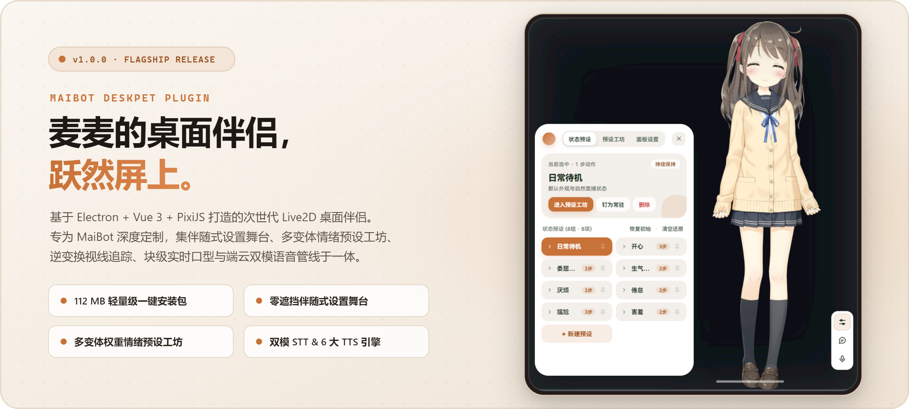
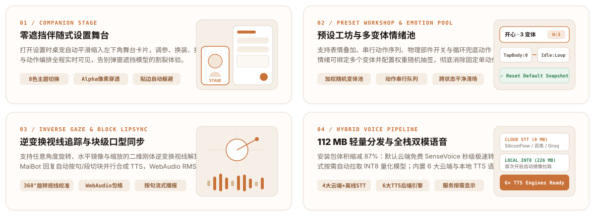

<div align="center">

<picture>
  <source media="(prefers-color-scheme: dark)" srcset="docs/assets/hero-dark.png" />
  <source media="(prefers-color-scheme: light)" srcset="docs/assets/hero-light.png" />
  
</picture>

<br />

[](https://github.com/Maboroshinatsu/maibot-deskpet-plugin/releases/tag/v1.0.1)
[](https://github.com/Maboroshinatsu/maibot-deskpet-plugin/releases/download/v1.0.1/MaiBot-Deskpet-Setup-1.0.1.exe)
[](https://github.com/Maboroshinatsu/maibot-deskpet-plugin/releases/download/v1.0.1/MaiBot-Deskpet-Portable-1.0.1-win-x64.zip)
[](https://www.electronjs.org/)
[](https://www.live2d.com/)
[](https://github.com/MaiM-with-u/MaiBot)
[](LICENSE)

**[下载安装包](https://github.com/Maboroshinatsu/maibot-deskpet-plugin/releases/tag/v1.0.1)** &nbsp;·&nbsp; **[使用指南](docs/GUIDE.md)** &nbsp;·&nbsp; **[部署配置](docs/SETUP.md)** &nbsp;·&nbsp; **[模型适配规范](docs/MODEL-ADAPTER-SPEC.md)** &nbsp;·&nbsp; **[v1.0 更新日志](docs/UPGRADE-AND-FIX-LOG-2026-10-12.md)**

</div>

<br />

<picture>
  <source media="(prefers-color-scheme: dark)" srcset="docs/assets/bento-dark.svg" />
  <source media="(prefers-color-scheme: light)" srcset="docs/assets/bento-light.svg" />
  
</picture>

---

## 快速开始

**1. 安装桌面端**  
前往 [**Releases**](https://github.com/Maboroshinatsu/maibot-deskpet-plugin/releases/tag/v1.0.1) 下载并运行安装版 **`MaiBot-Deskpet-Setup-1.0.1.exe`**，或下载免安装便携版 **`MaiBot-Deskpet-Portable-1.0.1-win-x64.zip`** 解压即用。

**2. 接入 MaiBot 插件**  
将本仓库克隆至 MaiBot 的 `plugins/` 目录，重启 MaiBot 即可自动监听 `127.0.0.1:8523`：
```bash
cd /path/to/MaiBot/plugins
git clone https://github.com/Maboroshinatsu/maibot-deskpet-plugin.git maibot_deskpet_plugin
```

**3. 配置语音（可选）**  
右键桌宠打开 **「设置 → 服务」**：
- **TTS 语音合成**：支持阿里云百炼、硅基流动、Fish Audio、小米 MiMo、自定义 OpenAI 兼容接口及本地 GPT-SoVITS。
- **STT 语音识别**：默认使用云端硅基流动 SenseVoice（免费极速、零体积）；也可切换为本地 SenseVoice INT8（首次启用自动按需下载 `226 MB` 模型）。

---

## 文档导航

| 文档 | 说明 |
| :--- | :--- |
| [**《使用与进阶指南》**](docs/GUIDE.md) | 语音服务详细对比、系统架构图、交互快捷键速查、源码构建与目录结构 |
| [**《部署与配置指南》**](docs/SETUP.md) | 插件端 `config.toml` 配置、局域网跨设备连接与常见问题排障 |
| [**《Live2D 模型适配规范》**](docs/MODEL-ADAPTER-SPEC.md) | 自定义模型导入、能力清单导出与 AI 辅助生成 `deskpet-adapter.json` |
| [**《v1.0.0 升级与修复记录》**](docs/UPGRADE-AND-FIX-LOG-2026-10-12.md) | v1.0.0 架构重构、状态机修复与轻量化分发演进归档 |

---

## 致谢

- **[MaiBot](https://github.com/MaiM-with-u/MaiBot)** — 插件运行的宿主平台
- **[Airi](https://github.com/moeru-ai/airi)** — PixiJS Live2D 渲染方案的重要参考
- **[NachoBot](https://github.com/RachelForster/Shinsekai)** — GPT-SoVITS 集成方案与音频处理管线参考
- **[GPT-SoVITS](https://github.com/RVC-Boss/GPT-SoVITS)** — 语音合成引擎
- **[Sherpa-ONNX](https://github.com/k2-fsa/sherpa-onnx)** — SenseVoice 语音识别运行时
- **[NapCat](https://github.com/NapNeko/NapCatQQ)** — 图片消息格式参考
- **[pixi-live2d-display](https://github.com/guansss/pixi-live2d-display)** — PixiJS Live2D 渲染封装库

---

## 开源协议与素材声明

- **项目源码**：本仓库所有自研代码与静态立绘示例包（`sample_static`）均基于 [MIT License](LICENSE) 开源。
- **Live2D Web 运行时与示例模型**：`live2dcubismcore.min.js`（Live2D Cubism SDK for Web 核心脚本）及默认内置示例模型 **「桃濑日和 (Hiyori Momose / 桃瀬ひより)」** 版权归 **Live2D Inc.** 所有，依据 [Live2D Proprietary Software License Agreement](https://www.live2d.com/eula/live2d-proprietary-software-license-agreement_en.html) 与 [Live2D Free Material License Agreement](https://www.live2d.com/eula/live2d-free-material-license-agreement_en.html) 随开源项目分发演示，不包含在 MIT 源码协议授权范围内。

---

## Code Signing & Privacy Policy

### Code Signing Policy
Free code signing is provided by [SignPath.io](https://signpath.io/), and the code signing certificate is provided by the [SignPath Foundation](https://signpath.org/).

- **Committers and Reviewers**: [Maboroshinatsu](https://github.com/Maboroshinatsu)
- **Approvers**: [Maboroshinatsu](https://github.com/Maboroshinatsu)

All official Windows release binaries are built reproducibly from source via [GitHub Actions](.github/workflows/release.yml).

### Privacy Policy
This program will not transfer any information to other networked systems unless specifically requested by the user or the person installing or operating it.
- By default, the desktop companion connects only to the user's local MaiBot WebSocket endpoint (`ws://127.0.0.1:8523/ws`).
- No telemetry, analytics, or background tracking is collected or transmitted. External network requests (such as cloud STT/TTS API calls or optional local ASR model downloads) occur strictly when explicitly configured and triggered by the user.

