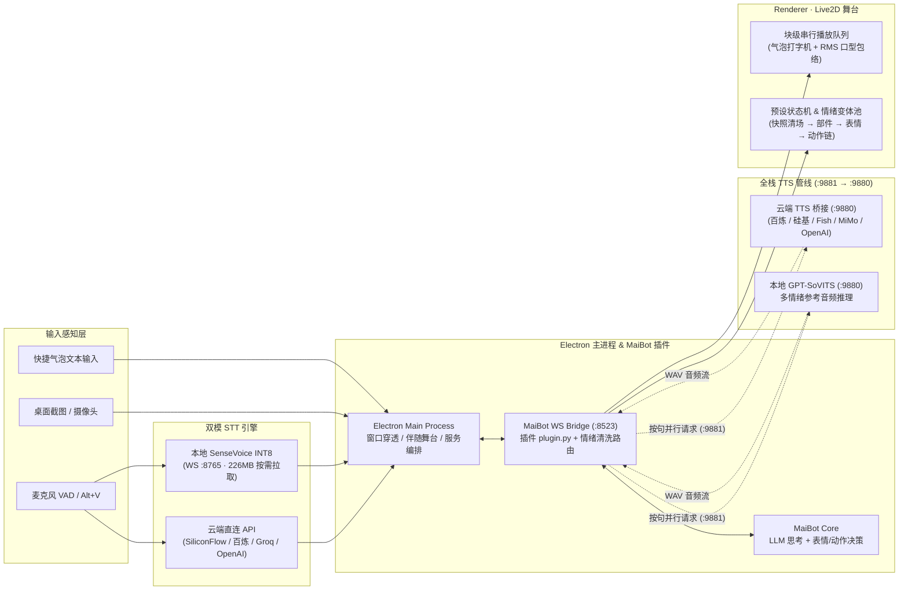

# MaiBot Deskpet 使用与进阶指南

本文档包含 **MaiBot Deskpet** 的语音服务对比、系统架构、交互操作速查与源码构建说明。

- 如果你需要了解插件安装与跨设备连接配置，请参阅 [**《部署与配置指南 (SETUP.md)》**](SETUP.md)。
- 如果你需要导入并适配自己的 Live2D 模型，请参阅 [**《Live2D 模型适配规范 (MODEL-ADAPTER-SPEC.md)》**](MODEL-ADAPTER-SPEC.md)。
- 如果你想查阅 v1.0.0 的底层重构细节，请参阅 [**《v1.0.0 升级与修复全记录》**](UPGRADE-AND-FIX-LOG-2026-10-12.md)。

---

## 1. 轻量化双模语音管线对比

桌宠的「服务」设置面板会根据当前所选模式**按需显示**相关进程与配置项：

| 模块 | 支持模式 / 平台 | 本地体积 | 特性与适用场景 |
| :--- | :--- | :--- | :--- |
| **语音识别 (STT)**<br/><sub>支持 VAD 自动唤醒<br/>与 Alt+V 按住说话</sub> | **硅基流动 SiliconFlow** `默认` | `0 MB` | 调用 `FunAudioLLM/SenseVoiceSmall`，免费额度充足，免装即用、响应极快 |
| | **阿里云百炼 DashScope** | `0 MB` | 支持 `paraformer-realtime-v2` 等模型；若 TTS 已填百炼 Key，留空可自动复用 |
| | **Groq Whisper** | `0 MB` | 调用 `whisper-large-v3-turbo`，极低延迟多语种识别 |
| | **自定义 OpenAI 兼容** | `0 MB` | 兼容任意提供 `/v1/audio/transcriptions` 接口的第三方或局域网服务 |
| | **本地 SenseVoice INT8** | `226 MB` <sub>按需安装</sub> | 完全离线可用；首次启用时自动从国内镜像 `hf-mirror.com` 下载至 `%APPDATA%\maibot-deskpet\sensevoice` |
| **语音合成 (TTS)**<br/><sub>按句并行预合成<br/>WebAudio 实时口型</sub> | **阿里云百炼 CosyVoice** | `0 MB` | 支持音色克隆与指令控制（`cosyvoice-v3-flash` 等），情感细腻 |
| | **硅基流动 CosyVoice2** | `0 MB` | 支持 `FunAudioLLM/CosyVoice2-0.5B` 预置音色与参考克隆，可与云端 STT 共用 Key |
| | **Fish Audio** | `0 MB` | 接入二次元社区音色库，填入 `reference_id`（模型 ID）即可驱动 |
| | **小米 MiMo-TTS** | `0 MB` | 支持对话情感风格标签控制 |
| | **自定义 OpenAI 兼容** | `0 MB` | 支持任意标准 `POST /v1/audio/speech` 端点（OpenAI TTS、自建网关等） |
| | **本地 GPT-SoVITS** | `自备服务端` | 直连本地 `127.0.0.1:9880` 推理服务，支持按情绪动态切换参考音频 |

---

## 2. 系统架构与数据流



---

## 3. 桌面交互速查表

| 交互操作 | 触发方式 | 行为说明 |
| :--- | :--- | :--- |
| **部位触碰互动** | 左键单击模型不同区域 | 自动识别头部 / 面部 / 身体 / 腿部等 HitArea，触发触碰反应并通知 MaiBot |
| **拖拽移动窗口** | 左键按住模型拖动 | 自由移动桌宠位置；拖拽至屏幕左右边缘自动进入半身探出躲避模式 |
| **无级缩放模型** | 鼠标滚轮滚动 | 在 `0.25x ~ 2.5x` 范围内平滑缩放模型尺寸 |
| **旋转模型角度** | `Alt` + 鼠标滚轮 | 在 `-180° ~ 180°` 范围内自由旋转模型（视线追踪与点击区域自动逆变换校准） |
| **按住说话 (PTT)** | 按住 `Alt + V` | 录音并在松开后自动识别发送（可在设置面板开启 VAD 全自动免按键语音对话） |
| **快捷操作栏** | 鼠标悬停桌宠底部 | 呼出文字输入框、语音开关、桌面截图发送、摄像头拍照与伴随设置入口 |

---

## 4. 源码开发与打包构建

### 环境要求
- **Node.js** `>= 18`
- **Python** `3.10 ~ 3.12`

### 启动开发模式
```bash
cd deskpet-app
npm install
npm run dev
```

### 构建 Windows 安装包 (`Setup.exe`)
项目在 [`deskpet-app/electron-builder.yml`](../deskpet-app/electron-builder.yml) 中配置了 NSIS 打包流水线：
```bash
cd deskpet-app
npm run dist
```
打包产物位于 `deskpet-app/release/MaiBot-Deskpet-Setup-1.0.0.exe`。

---

## 5. 仓库目录结构

```text
maibot-deskpet-plugin/
├── plugin.py                     # MaiBot 插件主入口（含 DeskpetPluginConfig 配置模板、消息流网关、按句并行 TTS 调度）
├── _manifest.json                # MaiBot 插件元数据清单（MIT）
├── cloud-tts-bridge.py           # 多平台云端 TTS 桥接服务（百炼 / 硅基流动 / Fish / MiMo / OpenAI 兼容）
├── gpt-sovits-bridge.py          # TTS 统一归一化桥接服务（监听 :9881 转发至 :9880）
├── stt-bridge.py                 # 本地 SenseVoice INT8 语音识别服务（支持按需自动下载模型至 %APPDATA%）
├── hotkey-bridge.py              # 全局快捷键监听服务（Alt+V 按住说话）
├── watchdog.py                   # 进程守护脚本
├── docs/
│   ├── assets/                   # 仓库自适应深浅色 SVG 视觉资产
│   ├── GUIDE.md                  # 完整功能、架构与构建指南（本文档）
│   ├── SETUP.md                  # 插件与桌面端详细部署指南
│   ├── MODEL-ADAPTER-SPEC.md     # Live2D 模型适配规范
│   ├── deskpet-adapter.schema.json # 模型适配文件 JSON Schema 校验定义
│   ├── IMAGE-SET.md              # 视觉识别参考图集配置说明
│   └── UPGRADE-AND-FIX-LOG-2026-10-12.md  # v1.0.0 升级与架构演进全记录
└── deskpet-app/                  # Electron 34 + Vue 3 + PixiJS 桌面端工程
    ├── electron-builder.yml      # Windows NSIS 安装包构建配置
    ├── src/main/                 # 主进程：透明穿透窗口、伴随舞台缩放、双模语音进程管理
    ├── src/preload/              # 预加载安全 IPC 桥接层
    └── src/renderer/             # 渲染进程：Live2D 控制器、逆变换视线、预设工坊、8 色主题面板
```
